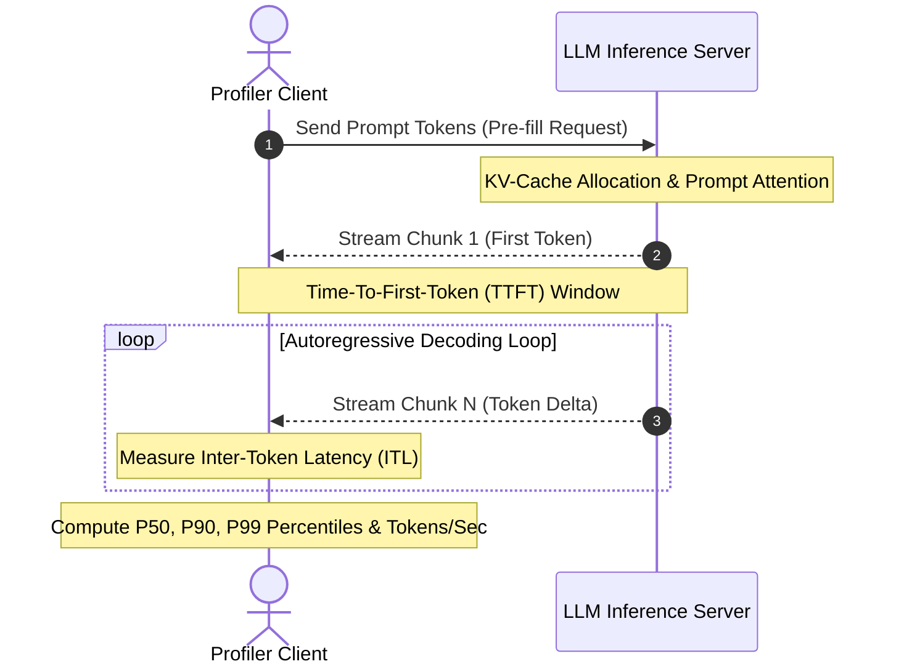

# inference-latency-profiler

[](https://github.com/GuptaSoujanya/inference-latency-profiler/actions)
[](https://opensource.org/licenses/MIT)
[](https://www.python.org/downloads/)

A high-precision, low-overhead latency and throughput profiler engineered for local and remote LLM inference engines (vLLM, Ollama, llama.cpp, TensorRT-LLM).

---

## Latency Decomposition Model



---

## Key Metrics Profiled

- **Time-to-First-Token (TTFT):** Measures pre-fill processing time and time until first token emission.
- **Inter-Token Latency (ITL):** Measures consecutive token emission intervals throughout autoregressive generation.
- **Throughput ($tokens/sec$):** End-to-end token generation rate under target concurrency.
- **Percentile Distributions ($P_{50}, P_{90}, P_{95}, P_{99}$):** High-resolution tail-latency identification.
- **Terminal Visualization:** Real-time ASCII distribution histograms right in your console.

---

## Installation

```bash
git clone https://github.com/GuptaSoujanya/inference-latency-profiler.git
cd inference-latency-profiler
pip install -e .
```

---

## Quickstart

Run a fast profile benchmark:

```bash
python -m profiler.cli --model qwen-2.5-7b --requests 5 --tokens 32
```

Sample Output:
```text
========================================================
         INFERENCE LATENCY PROFILE REPORT
========================================================
 Total Requests Completed    : 5
 Total Tokens Sampled        : 160
 Overall Token Throughput    : 54.21 tokens/sec
--------------------------------------------------------
 Time-To-First-Token (TTFT)  : Mean = 64.12 ms
   P50: 63.80 ms | P90: 71.40 ms | P99: 74.20 ms
--------------------------------------------------------
 Inter-Token-Latency (ITL)   : Mean = 18.04 ms
   P50: 17.90 ms | P90: 21.30 ms | P99: 23.40 ms
--------------------------------------------------------
 Memory Footprint            : RSS = 42.4 MB | Peak VRAM = 3420.0 MB
========================================================

--- Inter-Token Latency Distribution ---
[  14.5 -   16.3 ms] | ##########                     (28)
[  16.3 -   18.1 ms] | ############################## (82)
[  18.1 -   19.9 ms] | #################              (45)
[  19.9 -   21.7 ms] | ##                             (5)
```

---

## Running Test Suite

```bash
python -m unittest discover tests -v
```

---

## License

This project is licensed under the MIT License - see the [LICENSE](LICENSE) file for details.
